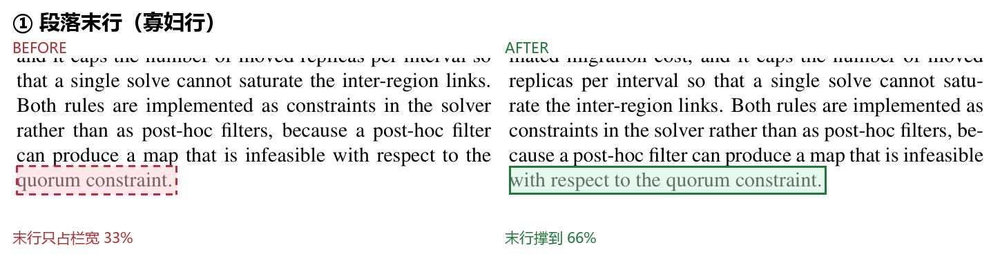
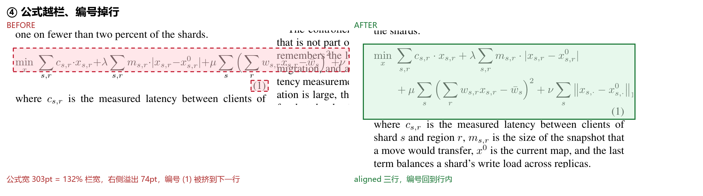
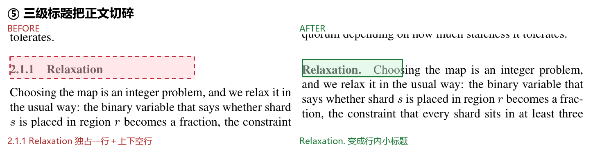
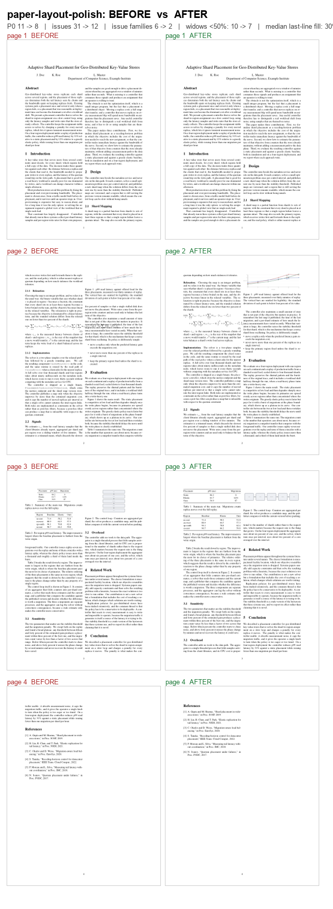
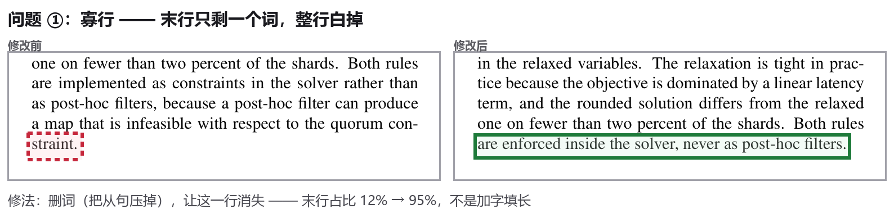
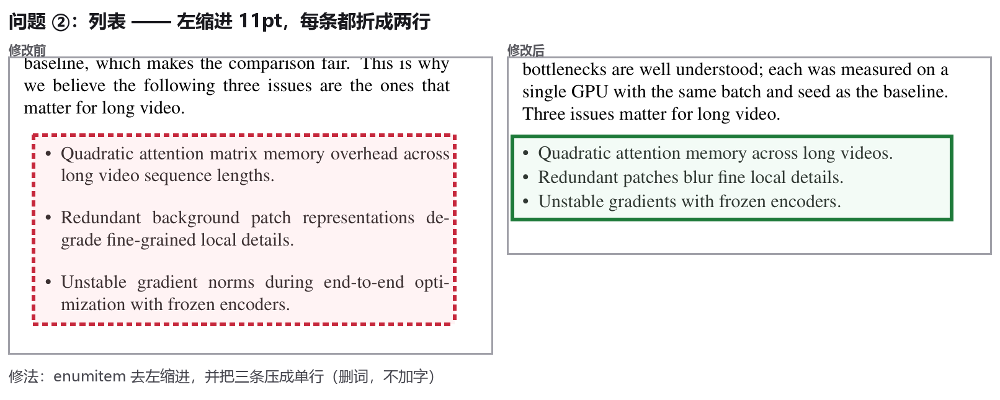
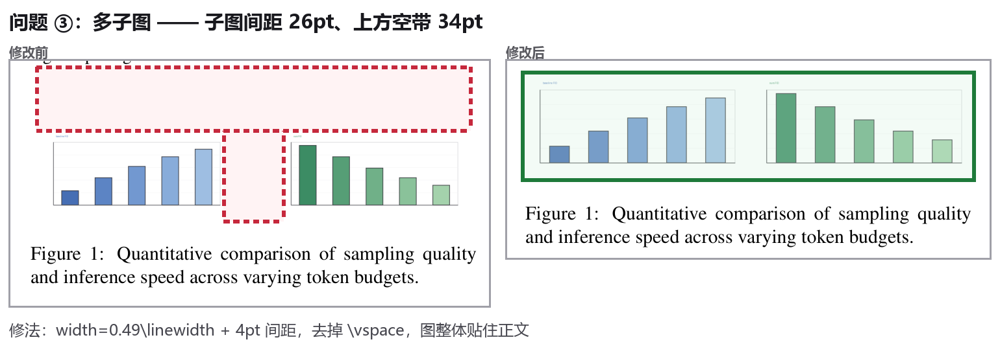

# paper-layout-polish

顶会论文版面美化：把「不均匀空白」量化成可复核的证据，再按你审核的范围去改。

方法来自《提升顶会投稿美感的六大焚决》（Alonzo）：把 PDF 缩到 50%、退后半步看轮廓——好论文每栏的文字与图表应该拼成**边缘锋利、深浅一致的矩形色块**，空白只允许出现在栏间中缝、页边距和段落过渡处。凡破坏这个矩形的空白，就是“不均匀空白”。关键是**消除**而不是减少：剩一处，整体观感就还是脏的。

## 安装

这个仓库本身就是一个技能包（`SKILL.md` + `references/` + `scripts/`），装进 DSH 的用户技能目录即可被自动发现：

```bash
git clone https://github.com/9527La/paper-layout-polish.git ~/.dsh/skills/paper-layout-polish
```

Windows 下目标目录是 `C:\Users\<你>\.dsh\skills\paper-layout-polish`。依赖只有 Python 3 + PyMuPDF：

```bash
pip install pymupdf
```

## 目录结构

```text
SKILL.md                    技能说明（何时用、三段流程、参数与退出码）
references/rubric.md        六类判据、硬阈值/目标、P0–P3 定义
references/latex-fixes.md   修法：删词滑块表、tabular*、align、enumitem…
references/figure-fixes.md  构图与宽高比、matplotlib 片段
references/report-template.md Phase 1/2/3 的报告骨架
scripts/audit_layout.py     审计脚本（PyMuPDF，输出 Markdown + JSON + 裁剪图）
examples/demo2/             自测：4 页假论文的前后对照（含 before/after 报告）
examples/demo3/             自测：列表、多子图、寡行「删掉」三处局部对照
```

## 三段流程（不会直接改你的稿子）

1. **检查与呈现** — 定位 `paper.tex` / `paper.pdf`，跑审计脚本，生成带裁剪图的报告；脚本看不到的（legend 遮挡、子图刻度、流程图构图）用人眼补。最后**停下来**，把“需要你决定的”列清楚：全修 / 只修 P0 / 逐条挑 / 先不改。
2. **用户审核** — 复述 in-scope 与 out-of-scope，确认后再动。说“你看着办”时默认只动 P0+P1。
3. **执行修改** — 顺序是源码级 → 大对象（图/表/公式）→ 文本级。每改一批必须“改→编译→复跑→比数字”，没改善就回退并标“已尝试/未生效”，最后给 before/after 表。

## 能自动检出并给出修法的

| 类别 | 判据 | 修法 |
|---|---|---|
| 寡行 / 矮行 | 段落末行 < 50% 栏宽（硬阈值），目标 70–80% | 删词/换短表述让这一行**消失**（首选）；填充只作最后手段 |
| 孤行 | 段落首行独占栏尾 / 末行孤悬栏首 | `\needspace`、`\enlargethispage` |
| 越界与公式编号 | 行/公式超栏宽；公式吃满栏宽把编号挤到下一行 | `align`+`&` 分算子对齐、留编号位、不拆语义项 |
| 图 | 未撑满栏宽（< 92%）、竖向图、全宽图越界 | `width=\linewidth`、改成 ≥3:1 的长条图 |
| 多子图 | 子图间距 > 8pt 或左右不均、图上空带 > 2.2 行距、整体 < 90% 栏宽 | 0.49+0.49、缝 4pt、去掉 `\vspace` |
| 列表 | 左缩进 > 8pt、条目末行普遍 < 50%、条目间距大于行距 | `enumitem` 去缩进 + 每条压成一行（删词） |
| 表 | 未撑到页边距、全文表内字号不统一 | `tabular*`+`@{\extracolsep{\fill}}`、统一 `\small` |
| 源码级 | `\subsubsection`、`\texttt{}`、repo 式调用、无 `enumitem` 的列表 | 降为 `\paragraph`、改 `\emph`/数学符号、加紧凑列表设置 |
| 栏底空白 | 栏底大片留白（float 逃逸或强行断页） | 调 float 位置、`\enlargethispage` |

脚本还处理了几类容易误报的情形：整宽标题/摘要/跨栏图、running head、版权声明（按版心而非单栏比宽度）；IEEE 式右对齐公式编号（会并回公式行）；上下标碎片（按竖直内含关系并入）；单栏文档不会误判成双栏（有中缝自洽检查 + 跨中线行数守卫）。

## 实测：合成论文 4 页（demo2）

自己造的假论文《Adaptive Shard Placement for Geo-Distributed Key-Value Stores》，人为种入六类缺陷，跑完整三段流程：

| 指标 | 修复前 | 修复后 |
|---|---|---|
| P0 / 问题总数 | 11 / 31 | **8 / 12** |
| 命中问题族 | 6（寡行、越界、表、孤行、源码级、图） | **2（寡行、越界）** |
| 段落末行 < 50% | 10 / 15 段 | **7 / 17 段** |
| 末行占比中位数 | 30% | **37%** |
| 表格宽度 | 66% / 58%，且字号 8–9pt 不统一 | **100% / 100%**，字号统一 |
| 图片宽度 | 68% / 55% | **100% / 100%**（竖向流程图换成横条图） |
| 公式 | 越栏 158%，编号掉到下一行 | 编号回到行内，残留 10.4pt 微溢 |
| 源码级 | `\subsubsection`×2、`\texttt`×3、默认 itemize | **0** |

逐条局部对照：左栏红虚线框 + 浅红底＝被审计判为问题的地方，右栏绿实线框 + 浅绿底＝修好之后的同一处。

**① 段落末行只占栏宽 33% → 66%**



**② 表格没有撑满栏宽（151pt / 229pt，两侧各空 39pt）→ `tabular*` 拉满**


**③ 图只占 68% 栏宽、右侧空 73pt → `width=\linewidth` 顶到栏边**


**④ 公式宽 131% 栏宽、越出栏外，编号 (1) 被挤到下一行 → `aligned` 三行，编号回到行内**



**⑤ `2.1.1` 三级标题独占一行、上下各留一段白 → 改成行内 `\paragraph{Relaxation.}`**



整页对照（缩到 50% 看版面轮廓，正是这套判据的观察方式）：



值得记的两点：

- 结构修复（换 `tabular*`、撑满图宽、公式改多行）会让文本重排，**寡行数一度从 14 涨到 18**——所以必须复跑，再针对新的末行做文本级调整，这批调整把 <50% 从 12 降到 7。
- 修复过程本身逼出了脚本的两个假阳性族（跨栏合并成一行导致假右溢、公式编号被误判掉行），已修进脚本。

## 实测：合成论文 1 页（demo3，列表 / 多子图 / 寡行「删掉」）

第二个自造样本，专门压这三类问题：三条各自折成两行的 `itemize`、两个 0.42 宽且中间夹 26pt 缝、上方还有 18pt `\vspace` 的子图、以及一段末行只剩 `straint.`（占 12%）的段落。

| 指标 | 修复前 | 修复后 |
|---|---|---|
| 寡行 | 4 条（12.0% / 37.9% / 47.7% / 42.1%） | **1 条（47.7%）**，且 12% 那条是**整行消失** |
| 列表 | P2：左边距 11pt、条目末行中位 63% | 三条都压成单行，缩进归零 |
| 多子图 | P2：间距 26–26pt、上方空带 34pt | 0.49+0.49、缝 4pt、无空带 |
| 表 | P1：147/229 = 64% | 未在 demo 中处理（同类修法见 demo2 ②） |

**⑥ 寡行：删词让末行整行消失，12% → 95%（不是加字把它填长）**



**⑦ 列表：左边距 11pt + 每条两行 → `enumitem` 去缩进，三条各压成一行**



**⑧ 多子图：26pt 缝 + 18pt `\vspace` 叠出 34pt 空带 → 0.49+0.49、缝 4pt、贴住正文**



demo3 的另一个作用：说明**删词会重排整栏**。第一次删完，12% 的尾巴没了，却在下一页新生出 8.4% 和 30.6% 两条新尾巴——所以每条修改都要编译 + 复跑，不能攒着改。

## 实测：其他语料

- 自带 fixture（2 页双栏，种 6 类缺陷）：P0 11 → 修 4 处后 9，“越界”和“图”两节整节消失。
- IEEE Trans. Smart Grid 真论文前 4 页：P0 4 / P1 6 / P2 1，越界只剩 3 条真实的 2.2–2.6pt 微溢（版心 254.5pt，识别为 2 栏）。
- 单栏 letterpaper 文档：正确识别为 1 栏（468.1pt），仍报出 25% 宽的窄表。

## 用法

```bash
python scripts/audit_layout.py --pdf paper.pdf --tex paper.tex \
       --md audit.md --json audit.json --crops crops --render thumbs --zoom 0.5
```

- 退出码：`1` 有 P0，`0` 干净，`2` 参数/读取错误——可直接进 CI。
- 先看报告开头四行自检：页数、`N 栏`、正文字号、行距。栏数与字号不对，后面所有度量都不可信。
- `--crops` 给图/表出裁剪图；`--render` + `--zoom 0.5` 出 50% 缩略图用于看轮廓。
- 报告只出证据和候选，**判定权在你**；Phase 3 的改动一律先审核。

## 局限（脚本看不到的）

- legend 是否压住数据点、子图刻度是否对齐、流程图构图是否“像拍照一样占满 70%”——这些要人眼。
- `figure*` / `table*` 以版心为基准判断宽度。
- 最后一页的空白通常由内容量决定，不算版面缺陷。
- 端到端只测过 LaTeX；PDF 需由 TeX 正常产出（有 `.tex` 才能做源码级检查）。

## License

MIT © 9527La
