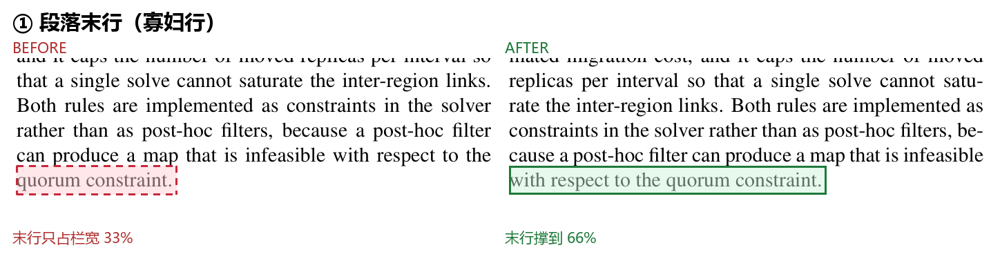
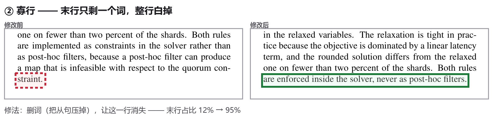
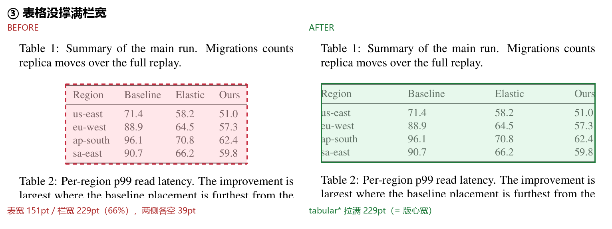
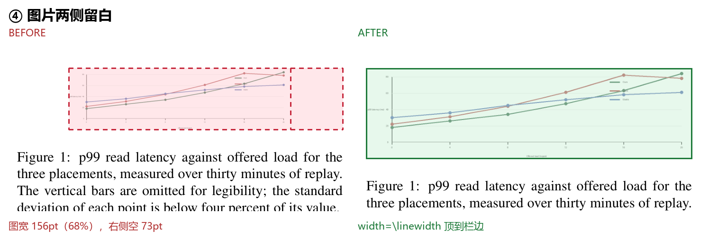
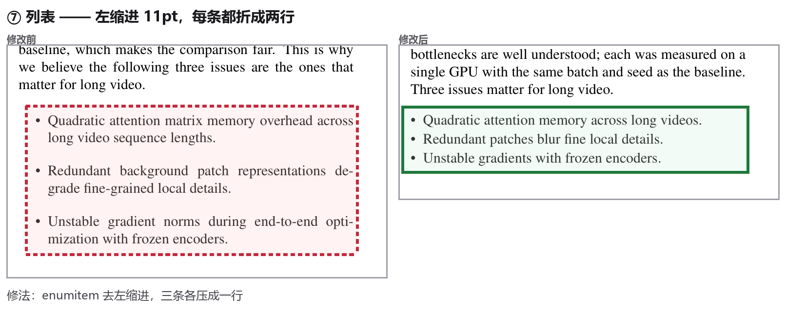
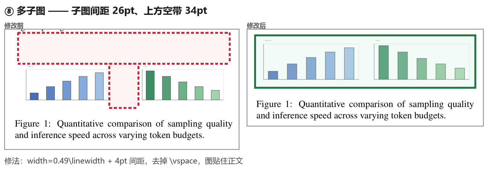

# paper-layout-polish

顶会论文版面美化：把「不均匀空白」量化成可复核的证据，按你审核的范围去改。

方法来自《提升顶会投稿美感的六大焚决》（Alonzo）：把 PDF 缩到 50%、退后半步看轮廓——每栏的文字与图表拼成**边缘锋利、深浅一致的矩形色块**，空白只出现在栏间中缝、页边距和段落过渡处。破坏这个矩形的空白，就是「不均匀空白」。要的是**消除**：剩一处，整体观感就还是脏的。

## 安装

这个仓库是一个技能包（`SKILL.md` + `references/` + `scripts/`），装进 DSH 的用户技能目录即可被自动发现：

```bash
git clone https://github.com/9527La/paper-layout-polish.git ~/.dsh/skills/paper-layout-polish
```

Windows 下目标目录是 `C:\Users\<你>\.dsh\skills\paper-layout-polish`。依赖只有 Python 3 + PyMuPDF：

```bash
pip install pymupdf
```

## 目录结构

```text
SKILL.md                       技能说明（何时用、三段流程、参数与退出码）
references/rubric.md           判据、硬阈值/目标、P0–P3 定义
references/latex-fixes.md      修法：删词滑块表、tabular*、align、enumitem…
references/figure-fixes.md     构图与宽高比、matplotlib 片段
references/report-template.md  Phase 1/2/3 的报告骨架
scripts/audit_layout.py        审计脚本（PyMuPDF，输出 Markdown + JSON + 裁剪图）
examples/compare/              8 组局部前后对照图（①–⑧）
examples/demo2/                4 页双栏样本的 tex、报告
examples/demo3/                1 页双栏样本的 tex、报告、出图脚本
```

## 三段流程

1. **检查与呈现** — 定位 `paper.tex` / `paper.pdf`，跑审计脚本，生成带裁剪图的报告；legend 遮挡、子图刻度、流程图构图由人眼补。最后**停下来**，列出待决定项：全修 / 只修 P0 / 逐条挑 / 先不改。
2. **用户审核** — 复述 in-scope 与 out-of-scope，确认后再动。说「你看着办」时默认只动 P0+P1。
3. **执行修改** — 顺序为源码级 → 大对象（图/表/公式）→ 文本级。每改一批「改→编译→复跑→比数字」，没改善就回退并标「已尝试/未生效」，收尾给 before/after 表。

## 能自动检出并给出修法的

| 类别 | 判据 | 修法 |
|---|---|---|
| 寡行 / 矮行 | 段落末行 < 50% 栏宽（硬阈值），目标 70–80% | 删词/换短表述让这一行**消失**；填充作最后手段 |
| 孤行 | 段落首行独占栏尾 / 末行孤悬栏首 | `\needspace`、`\enlargethispage` |
| 越界与公式编号 | 行/公式超栏宽；公式吃满栏宽把编号挤到下一行 | `align`+`&` 分算子对齐、留编号位、不拆语义项 |
| 图 | 未撑满栏宽（< 92%）、竖向图、全宽图越界 | `width=\linewidth`、改成 ≥3:1 的长条图 |
| 多子图 | 子图间距 > 8pt 或左右不均、图上空带 > 2.2 行距、整体 < 90% 栏宽 | 0.49+0.49、缝 4pt、去掉 `\vspace` |
| 列表 | 左缩进 > 8pt、条目末行普遍 < 50%、条目间距大于行距 | `enumitem` 去缩进 + 每条压成一行（删词） |
| 表 | 未撑到页边距、全文表内字号不统一 | `tabular*`+`@{\extracolsep{\fill}}`、统一 `\small` |
| 源码级 | `\subsubsection`、`\texttt{}`、repo 式调用、无 `enumitem` 的列表 | 降为 `\paragraph`、改 `\emph`/数学符号、加紧凑列表设置 |
| 栏底空白 | 栏底大片留白（float 逃逸或强行断页） | 调 float 位置、`\enlargethispage` |

脚本按版心判断整宽元素（标题、摘要、跨栏图、running head、版权声明），IEEE 式右对齐公式编号并回公式行，上下标碎片按竖直内含关系并入，单栏文档按中缝自洽检查识别为 1 栏。

## 前后对比：8 组局部截图

两个合成样本：4 页双栏（demo2，种入六类缺陷）与 1 页双栏（demo3，压列表、多子图、寡行删词）。左栏红虚线 + 浅红底是审计判为问题的地方，右栏绿实线 + 浅绿底是修好之后的同一处。

| # | 问题 | 修复前 | 修复后 | 样本 |
|---|---|---|---|---|
| ① | 段落末行 | 33% 栏宽 | 66% | demo2 |
| ② | 寡行·删词 | 末行只剩 `straint.`（12%） | 整行消失，段落收在 95% | demo3 |
| ③ | 表格宽度 | 151 / 229pt（66%），字号 8–9pt 混用 | `tabular*` 撑满 229pt，字号统一 | demo2 |
| ④ | 图片宽度 | 68% 栏宽，右侧空 73pt | `width=\linewidth`，100% | demo2 |
| ⑤ | 公式 | 宽 131% 栏宽、越出栏外，编号 (1) 掉到下一行 | `aligned` 三行，编号回到行内 | demo2 |
| ⑥ | 三级标题 | `2.1.1` 独占一行，上下各留一段白 | 行内 `\paragraph{Relaxation.}` | demo2 |
| ⑦ | 列表 | 左边距 11pt，三条各折两行 | 零缩进，三条各一行 | demo3 |
| ⑧ | 多子图 | 缝 26pt、上方空带 34pt | 0.49+0.49、缝 4pt、贴住正文 | demo3 |

**① 段落末行只占栏宽 33%，删词后回到 66%**



**② 寡行删词：末行整行消失，12% → 95%**



**③ 表格没撑满栏宽，两侧各空 39pt，`tabular*` 拉满**



**④ 图只占 68% 栏宽，`width=\linewidth` 顶到栏边**



**⑤ 公式 131% 栏宽、编号被挤到下一行，`aligned` 三行后编号回到行内**


**⑥ 三级标题独占一行、上下各留一段白，改成行内 `\paragraph`**


**⑦ 列表：左边距 11pt、每条两行，`enumitem` 去缩进后三条各一行**



**⑧ 多子图：26pt 缝 + 18pt `\vspace` 叠出 34pt 空带，改 0.49+0.49、缝 4pt**



## 两个样本的数字

| 指标 | 修复前 | 修复后 |
|---|---|---|
| demo2 P0 / 问题总数 | 11 / 31 | **8 / 12** |
| demo2 命中问题族 | 6（寡行、越界、表、孤行、源码级、图） | **2（寡行、越界）** |
| demo2 段落末行 < 50% | 10 / 15 段 | **7 / 17 段** |
| demo2 末行占比中位数 | 30% | **37%** |
| demo2 表格宽度 | 66% / 58%，字号 8–9pt 不统一 | **100% / 100%**，字号统一 |
| demo2 图片宽度 | 68% / 55% | **100% / 100%**（竖向流程图换成横条图） |
| demo2 公式 | 越栏 158%，编号掉行 | 编号回到行内，残留 10.4pt 微溢 |
| demo2 源码级 | `\subsubsection`×2、`\texttt`×3、默认 itemize | **0** |
| demo3 寡行 | 4 条（12.0% / 37.9% / 47.7% / 42.1%） | **1 条（47.7%）**，12% 那条整行消失 |
| demo3 列表 | P2：左边距 11pt、条目末行中位 63% | **零缩进，三条各一行** |
| demo3 多子图 | P2：缝 26–26pt、上空带 34pt | **缝 4pt、无空带** |
| demo3 表 | P1：147 / 229 = 64% | 报告列出 64%（修法同 ③） |

修复带来的两个连锁效应，两轮自测都测到了：

- **结构修复会重排文本。** demo2 换 `tabular*`、撑满图宽、公式改多行之后，寡行从 14 条涨到 18 条；针对新末行做文本级调整，才把 <50% 从 12 条降到 7 条。
- **删词会在别处生新尾巴。** demo3 第一次删完，12% 的尾巴没了，下一页新生出 8.4% 和 30.6% 两条。每条修改都要编译 + 复跑。

跨栏标题、版权声明、running head 这类整宽元素按版心判定，不计入越栏；公式编号与公式本体同基线时并回一行，上下标碎片按竖直内含关系并入。

## 实测：其他语料

- 自带 fixture（2 页双栏，种 6 类缺陷）：P0 11 → 修 4 处后 9，「越界」和「图」两节整节消失。
- IEEE Trans. Smart Grid 真论文前 4 页：P0 4 / P1 6 / P2 1，越界只剩 3 条真实的 2.2–2.6pt 微溢（版心 254.5pt，识别为 2 栏）。
- 单栏 letterpaper 文档：识别为 1 栏（468.1pt），报出 25% 宽的窄表。

## 用法

```bash
python scripts/audit_layout.py --pdf paper.pdf --tex paper.tex \
       --md audit.md --json audit.json --crops crops --render thumbs --zoom 0.5
```

- 退出码：`1` 有 P0，`0` 干净，`2` 参数/读取错误——可直接进 CI。
- 先看报告开头四行自检：页数、`N 栏`、正文字号、行距。栏数与字号不对，度量就是错的。
- `--crops` 出图/表裁剪图；`--render` + `--zoom 0.5` 出 50% 缩略图，按本 skill 的观察方式看版面轮廓。
- 报告给证据与候选修法，Phase 3 按审核后的范围改。

## 人眼判定的四类

- legend 是否压住曲线或数据点。
- 多子图之间刻度条数是否一致、图与页上沿的边距是否一致。
- 流程图是否按模块分区、整图是否填满且长大于宽。
- 最后一页的空白：按内容量判定。

## License

MIT © 9527La
